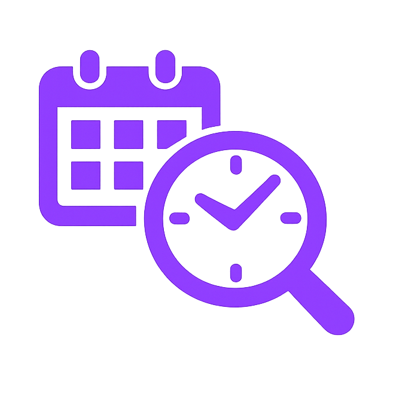

<p align="center">
  <a href="https://find-a-time.app">
    
  </a>
</p>

<h1 align="center">Let’s Find a Time!</h1>

<p align="center">
  Create a link, share it, and see when everyone can meet.
</p>

<p align="center">
  <a href="./LICENSE"></a>
  <a href="https://github.com/andresjmorales/find-a-time/commits/main"></a>
  <a href="https://github.com/andresjmorales/find-a-time/stargazers"></a>
  <a href="https://find-a-time.app"></a>
  <br>
  
  
  
  
  
  <a href="#deploy-on-vercel"></a>
  <a href="https://buymeacoffee.com/andresjmorales"></a>
</p>

<p align="center">
  <a href="https://find-a-time.app"><b>Try it</b></a> ·
  <a href="#how-it-works"><b>How it works</b></a> ·
  <a href="#screenshots-on-mobile-browser"><b>Screenshots</b></a> ·
  <a href="#getting-started"><b>Run locally</b></a>
</p>

A lightweight scheduling poll: pick dates and hours, share the event URL, and respondents mark slots as **Great**, **If needed**, or **Unavailable**. The app scores slots and surfaces the best times.

## How it works

1. **Create an event** (home page)  
   - Choose dates (calendar, today + next 2 days by default, up to 7 days), time range (e.g. 9 AM–5 PM), and your time zone (dropdown; defaults to browser). Event name is last, right above the create button.  
   - If you pick a time zone here, it’s pre-filled on the next screen so you don’t have to choose it twice. (If someone opens the shared link in a new tab, they see their own browser time zone.)  
   - Optional: expiration date and advanced options (disable “If needed”, weight for “If needed” in scoring, hide results until expiration).

2. **Share the link**  
   - You get a unique event URL (e.g. `/event/abc123`). Share it via WhatsApp, email, etc. The page title and Open Graph metadata include the event name for nice link previews.

3. **Respondents add availability**  
   - Open the link → **Add your availability** tab: your time zone is detected (or pre-filled if you just created the event and chose one). Change it in the dropdown if needed, then click or drag on the grid to mark slots as **Great** (green), **If needed** (yellow), or **Unavailable** (red). Optional free-text “Other availability” for times that don’t fit the grid. Name field sits just above **Submit availability**.

4. **View results**  
   - **Group results** tab: heatmap of who’s available when, plus **Top 3 suggested times** (scored by “Great” and “If needed” with configurable weight). Optional notes and “If needed” responses are summarized.

## Screenshots on mobile browser

| Home screen | Time picker | Results page |
|---|---|---|
|  |  |  |


## Features

- **Event options:** dates (default today + next 2 days), hours, timezone dropdown (pre-filled on availability screen when coming from creation), event name, optional expiration.  
- **Respondent experience:** grid in event timezone; Great / If needed / Unavailable; optional “If needed” and configurable weight in scoring; optional free-text availability.  
- **Results:** group availability grid, top 3 slots, optional “hide results until expiration.”  
- **Storage:** in-memory/JSON for local dev; **Upstash Redis** (or Vercel KV) in production.

## Tech stack

- **Next.js 16** (App Router), **React 19**, **TypeScript**, **Tailwind CSS**  
- **Storage:** `data/events.json` locally; **Upstash Redis** in production (env: `UPSTASH_REDIS_REST_URL` / `UPSTASH_REDIS_REST_TOKEN` or `KV_REST_API_URL` / `KV_REST_API_TOKEN`)

## Getting started

These steps work in PowerShell (pwsh), Windows Command Prompt, and common Unix shells.

1. **Install dependencies** (required before running the dev server):

   ```powershell
   npm install
   ```

2. **Start the development server:**

   ```powershell
   npm run dev
   ```

   Or with another package manager: `yarn dev`, `pnpm dev`, or `bun dev`.

Open [http://localhost:3000](http://localhost:3000) in your browser.

**Local dev:** Without Redis env vars, the app uses a local `data/events.json` file so you can run and test without setting up Redis.

## Deploy on Vercel

The app needs **persistent storage** in production. Vercel’s serverless environment has no writable disk, so events are stored in **Upstash Redis**.

1. Deploy the app to [Vercel](https://vercel.com/new).
2. In the Vercel project, go to **Storage** (or **Integrations**) and add **Upstash Redis** (create a database if needed).
3. After you **Connect to Project**, Vercel may set either `UPSTASH_REDIS_REST_URL` / `UPSTASH_REDIS_REST_TOKEN` or `KV_REST_API_URL` / `KV_REST_API_TOKEN`. The app supports both. Redeploy so the new env vars are used.

If those env vars are missing, the app will return an error and the UI will show the message from the server (e.g. to configure Upstash Redis).

## Learn more

- [Next.js Documentation](https://nextjs.org/docs)
- [Learn Next.js](https://nextjs.org/learn)

## License

[MIT](LICENSE)
